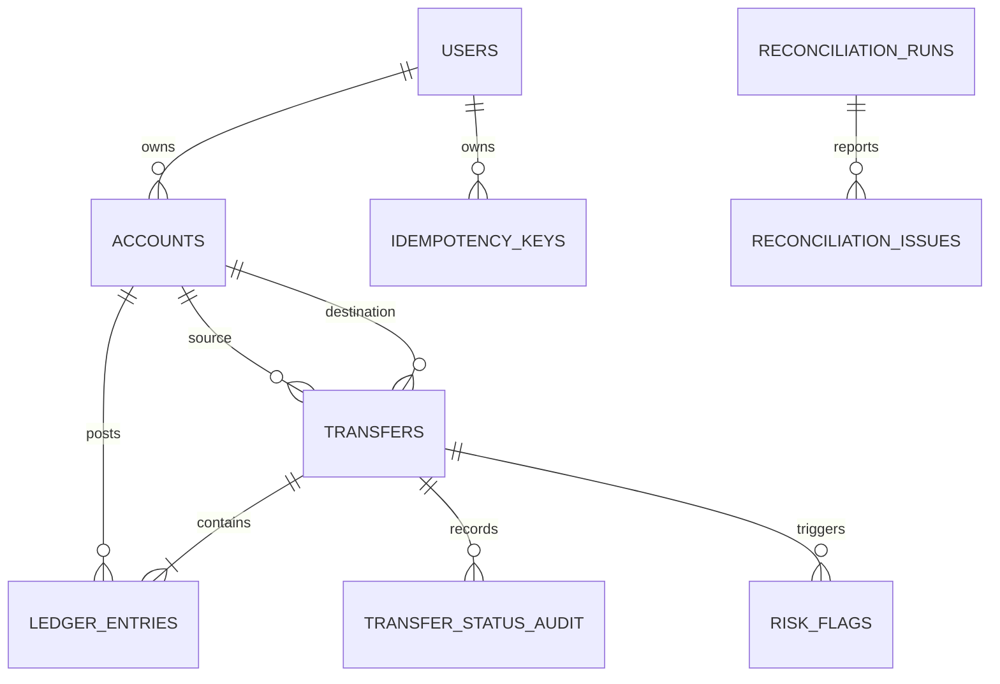

# Schema design

## Nouns and table decisions

| Noun | Table? | Reason |
|---|---|---|
| User | `users` | Identity, contact and KYC fields; owns many wallets. |
| Wallet/system account | `accounts` | A single account model simplifies posting, locking and reconciliation. |
| Transfer | `transfers` | Business event, amount, status, endpoints and reversal reference. |
| Ledger entry | `ledger_entries` | Immutable debit/credit posting lines. |
| Idempotency key | `idempotency_keys` | Per-user request hash and saved response. |
| Status history | `transfer_status_audit` | Actor, timestamp and reason for status changes. |
| Risk rule/flag | `risk_rules`, `risk_flags` | Configurable thresholds and decision/explanation data. |
| Reconciliation run/issue | `reconciliation_runs`, `reconciliation_issues` | Store each report and each detected mismatch. |
| Job lock | `job_locks` | Coordinates one reconciliation run at a time. |
| Statement | No | Derived from ledger rows. |
| Balance | Column | Cached for fast reads; nightly job compares it with the ledger. |
| Currency | No separate table | INR only, enforced by a check constraint. |

## Cardinalities

- `users 1:N accounts` through `accounts.user_id`.
- `accounts 1:N ledger_entries` through `ledger_entries.account_id`.
- `transfers 1:N ledger_entries` through `ledger_entries.transfer_id`.
- `accounts 1:N transfers` as source and destination via two foreign keys.
- `users 1:N idempotency_keys`, with unique `(user_id,key)`.
- `transfers 1:N transfer_status_audit` and `risk_flags`.
- `transfers 0..1:N transfers` through `reversal_of_transfer_id`.
- `reconciliation_runs 1:N reconciliation_issues`.

## ER diagram

## Decisions

Money is integer paise in `BIGINT`; never floating point. Ledger amounts are positive with direction stored separately. User wallets and system accounts share `accounts`, distinguished by `account_type` and nullable `user_id`. Email and phone are mutable/recyclable external attributes, not stable primary keys. Stored balances speed reads but add write complexity and require reconciliation. Ledger rows are protected by a database trigger; corrections should be reversal transfers.
